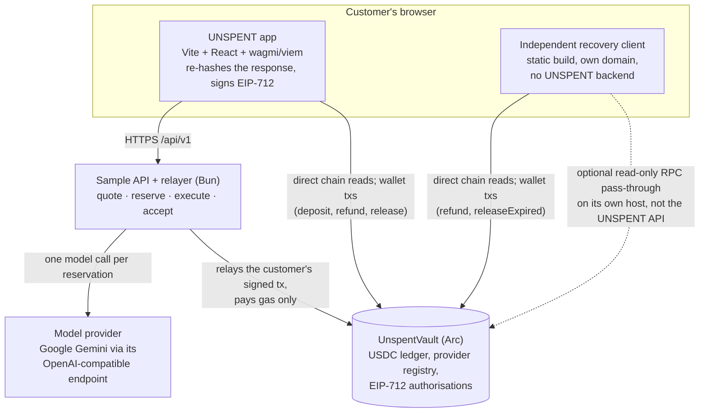

# UNSPENT

**Refundable, USDC-backed prepaid API credits on Arc.** A deposit and its credits are one atomic transaction, the provider is paid only after the customer accepts a specific response, and available funds can be recovered from the contract even when the provider's app is down.

Built with [Arc Studio](https://studio.arc.io) · [Live app](https://unspent-xi.vercel.app) · [Mainnet proof](https://unspent-xi.vercel.app/proof) · [Independent recovery client](https://unspent-recovery.pages.dev) · [Source](https://github.com/TheWeirdDee/unspent)

## 1. Product introduction

**Who needs this.** Developers who use small APIs — summarisation, OCR, translation, inference — prepay in stablecoins. Two things usually go wrong when they do. First, the payment and the credit often live in different systems, so a top-up can move money and create no balance. Second, getting an unused balance back depends on the provider's own billing database and support queue: if the service is down, suspended or simply unresponsive, the customer's money sits behind it.

**What UNSPENT does.** It moves the provider-specific prepaid balance into an Arc contract that holds USDC, and it keeps three things out of the provider's billing database:

- **Deposit and credit are one atomic transaction.** `deposit(providerId, amount)` pulls exactly the USDC it credits, in the same call, and rejects fee-on-transfer receipts, so "money moved, no credits" cannot happen inside the vault.
- **Payment follows acceptance.** A request reserves a bounded amount from the customer's available credits. The customer's wallet signs the hash of the response they actually saw and the amount they agreed to pay; only then is the provider's bound payout wallet paid, exactly that amount.
- **Recovery does not need the API.** Any time before acceptance, the customer can refund available credits, and after a reservation expires anyone can return it to available. A separate static client does this from its own domain using only the chain and the user's wallet.

The sample service behind the demo is **TextLab**, a three-bullet summarisation API backed by a real model, priced at 0.10 USDC per request.

## 2. Try it

| What | Where |
|---|---|
| Live app (Arc mainnet build) | https://unspent-xi.vercel.app |
| Public proof page — re-reads every receipt from the chain on load | https://unspent-xi.vercel.app/proof |
| Mainnet API health, version and network | https://unspent-api-mainnet.onrender.com/api/v1/health |
| Independent recovery client (Cloudflare Pages, different origin) | https://unspent-recovery.pages.dev |
| Docs, signatures and provider guide | https://unspent-xi.vercel.app/docs |
| Arc Studio project (owner-only, see [§5](#5-built-with-arc-studio)) | https://studio.arc.io/app/73cba122-05a1-4d3e-9f91-afb6132479b4 |

A three-minute walkthrough was recorded for the submission, but **no public URL has been published**, so none is linked here. The `/proof` page and the explorer links in [§4](#4-mainnet-evidence) are the verifiable substitute.

**Before you connect a wallet:** MetaMask flags both UNSPENT domains with a "deceptive site / signs of phishing or wallet-draining activity" warning. The cause is unresolved and the app neither hides nor bypasses it — see [§10](#10-verification-and-limitations).

## 3. What works today

The workflow below is what the running app does, in order. Everything is enforced by the contract; the API only orchestrates.

1. **Provider registration.** A provider owner registers a payout wallet and a metadata hash (`registerProvider`) and receives an immutable provider ID. Provider records can change only through a payout update (which bumps a payout version, so old signatures stop matching) and an active flag; deactivating a provider never blocks refunds or reservation releases.
2. **Exact-amount approval, then deposit.** The wallet approves the exact amount, then `deposit(providerId, amount)` pulls it and credits it atomically. An approval on its own creates nothing, and the UI says so. A reverted transfer changes no state.
3. **Quote and bounded reservation.** The API quotes a price. The wallet signs an EIP-712 `ReserveAuthorisation` binding provider, payout wallet, payout version, customer, request hash, maximum amount, nonce, signed submission deadline and reservation expiry. Any relayer may submit it (`reserveWithSignature`); the relayer pays gas and cannot alter amounts, destinations or timing. In the app a reservation is max 0.10 USDC with a 20-minute expiry and a 5-minute signing window; on-chain the hard caps are a non-zero amount, an expiry later than the signed deadline, and no more than one day out. Replay and duplicate request hashes are rejected.
4. **Execution.** The API makes one model call per reservation (a process-local lock rejects concurrent executes with `409 IN_PROGRESS`) and returns the response with its hash. Outputs are kept in memory for 30 minutes and cleared on restart; they are never persisted.
5. **Browser-verified response hash.** The browser re-hashes the exact text on screen and only then asks the wallet to sign the EIP-712 `DeliveryAcceptance`. A guard rejects a mismatched hash, an amount above the quote or reservation, a different customer, provider, request hash or payout, and malformed amounts, before the wallet callback runs. Accept is disabled on any mismatch.
6. **Customer acceptance and settlement.** `acceptAndSettle` pays the payout wallet bound at reservation time, exactly the signed amount, no more than the reservation's maximum. The API, the relayer and the provider cannot settle alone: the contract requires the customer's signature (or a direct call by the customer via `settleDirect`). A replayed acceptance is rejected by both the API and the contract and moves no funds.
7. **Expiry release.** A reservation that is not accepted can be released from its expiry onward by anyone (`releaseExpired`), returning it to the customer's available credits. No token transfer happens, so a stuck provider cannot strand it.
8. **Refund.** `refund(providerId, amount)` returns available credits to the caller's wallet at any time, in full or in part. Reserved and settled funds are not refundable.

### What is implemented, what was verified live, what is only a regression test

| Status | What it covers |
|---|---|
| **Implemented and running** | The full flow above, the provider portal, on-chain activity history, the proof page, the independent recovery client, and the simulated-outage control (`/api/v1/demo/outage`, operator-token protected). |
| **Verified live on Arc mainnet with real USDC** | Deposit, customer-signed reservation, a real Gemini response, customer acceptance, settlement to the payout wallet, refund — one run, 0.20 in / 0.10 settled / 0.10 refunded. See [§4](#4-mainnet-evidence). |
| **Verified live on Arc Testnet** | The same journey with sandbox wallets (25/25 scripted checks, transaction hashes in `docs/real-journey.json`), plus a hosted outage test using the owner's own wallet where the API was genuinely suspended at its host. See [§10](#10-verification-and-limitations). |
| **Local or mock regression tests (not on-chain)** | Acceptance guard and delivery-hash tests, one-model-call-per-reservation, durable intent before irreversible steps, output retention, reconciliation of interrupted records, and the navigation and stale-result browser fixes. Details and limits in [docs/audit-response.md](docs/audit-response.md). |

## 4. Mainnet evidence

**Vault:** [`0xa73723023a25fB400A153AE82F7A87B93d305f49`](https://explorer.arc.io/address/0xa73723023a25fB400A153AE82F7A87B93d305f49) on Arc (chain 5042), deployed 1 Nov 2026.

| Step | Transaction | Amount |
|---|---|---|
| **Deposit** | [`0x3cae816d…d49cbf`](https://explorer.arc.io/tx/0x3cae816db4c81a692c7efa3ab8dcad7442fc2934c1371470be54b40ec9d49cbf) | 0.20 USDC in; credits issued in the same transaction |
| **Settlement** | [`0xf69425cd…2d601f`](https://explorer.arc.io/tx/0xf69425cd83bb79a8337913cc468925ff189d718b34022e6c39939b69162d601f) | 0.10 USDC to the provider's bound payout wallet |
| **Refund** | [`0x0b8c3b32…bdd11b`](https://explorer.arc.io/tx/0x0b8c3b32e777677f1ea41e449db4882f53f35c1bc1ee02f033132bad38bdd11b) | 0.10 USDC back to the customer |

The run completed: 0.20 deposited, 0.10 settled for one real `gemini-3.5-flash-lite` response, 0.10 refunded. The vault ended holding and owing 0. The customer's account reads deposited 0.20, settled 0.10, refunded 0.10. The full transaction list, decoded events, balances and gas are in [docs/mainnet-journey.md](docs/mainnet-journey.md).

**Whose wallets these are.** Both wallets belong to the builder: the customer account and the provider owner/payout account are the same person's two MetaMask accounts, and the provider (TextLab) is the builder's own service. This demonstrates the mechanism end to end with real funds. **It is not evidence of customer adoption, a second provider, or demand** — no external user has used UNSPENT.

**What this run is not.** One run, not a production claim; the app is not described as mainnet-ready; the contract is unaudited. The API stayed online throughout, so this is a payment proof, not an outage proof. The outage test was on Testnet ([§10](#10-verification-and-limitations)).

## 5. Built with Arc Studio

Studio is where the project was built. The work done there, stated conservatively:

- **Contracts.** The `UnspentVault` Solidity contract and its Foundry suite: the ledger, provider registry, EIP-712 authorisations, deadline and expiry rules, refund and release paths, reentrancy guards and invariant tests.
- **Testing.** The contract suite (192 tests plus 8 invariant properties, with fuzzing and static analysis), the protocol journey script, the browser deposit-and-recover script and the outage script, and the testnet reconciliation records.
- **App and service.** The Vite/React app (landing, app, docs, proof, provider portal), the Bun sample API and relayer, and the independent recovery client, plus the deployment configuration (`Dockerfile`, `render.yaml`, `vercel.json`).
- **Deployment.** The Arc Testnet deployment and provider registration, recorded in [`deployments.json`](deployments.json).

**Why Studio mattered.** The contract, its test suite, the app, the API and the testnet deployment lived in one sandbox. A change could go from Solidity to a recompiled ABI, a regenerated frontend contract module and a redeployed testnet contract without leaving the project, and the browser could be pointed at the result immediately. That loop is what produced a working end-to-end flow, a deployed testnet vault and the scripted journeys in a single session — the parts that were done later, outside Studio, were hardening and mainnet deployment rather than the core build.

**Concrete evidence.** The commit log contains 72 commits whose author field is "Arc Studio", from `2608e2a` ("checkpoint 1: UnspentVault contract, 200 Foundry tests, project scaffold", 1 Nov 2026 02:22 UTC) to `491a509` (08:05 UTC). The Studio screen recordings kept with the submission show the same build history, contract source, test run and preview inside the Studio UI, and the testnet deployment in `deployments.json` matches the artifacts those commits produced.

**What that evidence is and is not.** Git author strings are a record of who committed, not cryptographic proof of which tool wrote which line; anyone can set an author name. Treat the Studio recordings and the reproducible artifacts (contract bytecode, test suite, deployment addresses) as the stronger evidence, and the commit count as consistent with them rather than as definitive proof.

**Two limits, stated plainly.** The Studio project link is **owner-only**: opening it without the owner's session redirects to Studio's public homepage, so a reviewer cannot browse the history through it. Studio's Share menu offers hosting integrations (Netlify, Hugging Face, Vercel); there is **no public project-history link feature**, so none is claimed. The project URL above is the real one; the walkthrough shows it on screen.

**Done later, outside Studio** (75 further commits carry the builder's own git account as author, plus actions outside git entirely):

- The mainnet deployment, signed by the owner in their own MetaMask, and the mainnet documentation and proof section.
- Fixes from an independent review of the deployed app (browser-side response hashing, one model call per reservation, resuming a request after refresh, restart reconciliation) — per finding, with tests and remaining limits, in [docs/audit-response.md](docs/audit-response.md).
- Fixes for browsers whose privacy/ad blockers cancel `*.arc.io` RPC requests, including a same-origin RPC path in the app and a read-only pass-through in the recovery client.
- External hosting set up by hand: a Vercel project for the app, two Render services for the APIs, a Neon Postgres database, and a Cloudflare Pages project for the recovery client.
- CI, dependency advisories, and accuracy fixes to the documentation.

## 6. Why this approach

- **Atomic deposit and credit.** Because the token pull and the credit write are one call with an exact-received check, the classic "paid but not credited" failure has no window to occur in. The contract's USDC balance is the collateral; liability is tracked per provider and per customer.
- **Customer-bound authorization.** Nothing moves on a request until the customer's key signs a bounded reservation, and nothing is paid to the provider until the customer's key signs the response hash and amount. The relayer is untrusted infrastructure: it pays gas and can only submit what was signed.
- **Stable USDC pricing.** Prices and balances are integer micro-USDC (6 decimals, the ERC-20 view); the code never mixes in Arc's 18-decimal native gas view. Customers hold and recover dollars, not a volatile token.
- **Recovery independent of the billing API.** Refund and expiry release are contract calls against the chain. The recovery client is a separate static bundle, on a different host and domain, with no UNSPENT backend, no login and no database.

**The trade-off, stated as a trade-off.** Payment follows acceptance, so **a customer can receive a useful response and withhold acceptance**, leaving the provider unpaid until the reservation expires and the amount returns to the customer's available balance. That is the privacy-preserving, customer-protective side of the design, and it is a real economic risk for providers. The reverse risk (customer pays for a response they cannot use) is bounded by the reservation maximum and the refund path. This is **not a universal payment solution**: it suits small, verifiable, pay-per-call APIs where a bounded amount and a short acceptance window are acceptable, and it would need a different settlement policy (with explicit customer consent and its own security review) for high-value or long-running work.

## 7. Roadmap and potential

UNSPENT currently demonstrates **one provider, one service, one builder's wallets**. The goal is that other small API providers can offer refundable prepaid balances without writing their own payment protocol.

Everything below is **planned, not shipped**. Milestones carry acceptance criteria instead of release dates.

| Milestone | Planned work | Evidence of completion |
|---|---|---|
| **Harden the existing service** | Independent contract review; row-level transactional persistence instead of one JSON snapshot; stronger restart recovery; continue resolving the MetaMask classification. | Published findings and fixes; automated database-failure and interrupted-transaction tests against real Postgres. |
| **Package the integration** | A TypeScript SDK and a reference server for quoting, reservations, delivery hashing and acceptance, extracted from the sample API. | A second API service integrated using the published package and documentation, with no changes to the contract. |
| **Pilot with external providers** | Onboard providers outside this project and test the economics of the acceptance model. | Real pilot results covering successful payments, rejected responses, refunds, gas costs and support friction. |
| **Support software clients** | Document how scripts and agents can use the same bounded authorizations and recovery paths without a browser wallet. | A working programmatic client with explicit spending limits and replay tests. |

**What success would look like.** Another provider adopts UNSPENT; a customer recovers an unused balance while that provider's billing service is down; and the acceptance model proves economically workable with real payers. Provider protection against withheld acceptance remains a research question — any alternative settlement policy would require explicit customer consent and separate security review, not a silent change to the default.

## 8. Architecture and trust boundaries



**Trust boundaries.**

- **The contract is the financial truth.** Balances, reservations, refunds and settlements are contract state. The API never holds or moves customer funds.
- **The API is an orchestrator and metadata source.** It quotes, holds in-flight request records, calls the model, and submits signed transactions. If it is lost, only in-flight records (up to about 20 minutes old) and daily model counters are lost; money and credits are unaffected.
- **The relayer is untrusted infrastructure.** It pays gas and cannot change a signed amount, destination, deadline or expiry. It holds no customer keys.
- **The recovery client is independent.** It is a separate bundle with its own ABI and address config, on a different provider and domain, with no login, no database, no indexer and no relayer. Its optional RPC pass-through (`recovery/functions/rpc/[net].ts`) is a **read-only** JSON-RPC forwarder to Arc's public RPC, used because some blockers cancel `*.arc.io` requests. It is not the UNSPENT API and never sees keys.
- **Nothing is hidden from the chain.** Addresses, amounts, response hashes and payout wallets are public. See the privacy notes in `/docs`.

**Accounting invariants** (enforced and fuzzed):

- Per account: `available + reserved + spent + refunded = totalDeposited`.
- Contract-wide: `sum(available + reserved) = totalOutstandingLiability`, and the vault's USDC balance is at least that (`solvency()`).
- No function lets an administrator or provider withdraw customer liabilities; there is no owner, no proxy and no upgrade path.
- `authDeadline` is inclusive for submission; `expiry` must be later than it and at most one day after submission. Settlement requires `block.timestamp < expiry`; `releaseExpired` requires `block.timestamp >= expiry`.

## 9. Developer setup

Prerequisites: [Bun](https://bun.sh) 1.3+, [Foundry](https://book.getfoundry.sh), Git. Docker is optional (container build, local Postgres).

```bash
git clone https://github.com/TheWeirdDee/unspent.git && cd unspent
git clone --depth 1 --branch v1.10.0 https://github.com/foundry-rs/forge-std lib/forge-std   # only if lib/forge-std is absent
bun install
bun --cwd recovery install        # optional: the recovery client also builds from the root install

# environment files (each component has its own; real files are git-ignored)
cp .env.example .env                     # frontend, PUBLIC VITE_* values only
cp server/.env.example server/.env       # backend secrets: relayer key, Gemini key, operator token, DATABASE_URL
cp recovery/.env.example recovery/.env   # recovery client, public values only (optional)
bun run gen:testnet-keys                 # optional: writes throwaway Arc Testnet keys into server/.env

bun run sync:deployments   # after any contract/address change: ABI + addresses into src/ and recovery/
bun run server             # API + relayer on :3001 (reads server/.env)
bun run dev                # app on :5173 (proxies /api to :3001 and /recovery-client to :5174)
bun run recovery:dev       # recovery client on :5174
```

Network defaults: `VITE_NETWORK` and `NETWORK` default to `testnet` (chain 5042002). Mainnet is chain 5042 and must be selected explicitly. Addresses and ABIs come from [`deployments.json`](deployments.json) and `contracts/out`; `bun run sync:deployments` writes them into `src/contracts` and `recovery/src/contracts`.

Real `.env` files are never committed, and **no secret may be placed in a `VITE_*` variable** — Vite bundles those into the browser.

| File | Component | Holds | Secret? |
|---|---|---|---|
| `.env` | Web app (Vite) | `VITE_NETWORK`, `VITE_API_BASE`, `VITE_RECOVERY_URL`, `VITE_STUDIO_URL`, `VITE_STUDIO_SHARE_URL` | No (public) |
| `server/.env` | API + relayer + test scripts | `NETWORK`, `PORT`, `TESTNET_RELAYER_KEY`, `MAINNET_RELAYER_KEY`, `LLM_API_KEY`, `LLM_BASE_URL`, `LLM_MODEL`, `LLM_*_LIMIT`, `LLM_TIMEOUT_MS`, `DEMO_OPERATOR_TOKEN`, `DATABASE_URL`, `CORS_ORIGINS`, `TESTNET_CUSTOMER_KEY`, `TESTNET_PROVIDER_OWNER_KEY`, `TESTNET_PAYOUT_KEY` | Yes |
| `recovery/.env` | Recovery client | nothing required | No |

Gemini: `LLM_BASE_URL=https://generativelanguage.googleapis.com/v1beta/openai` (the API appends `/chat/completions` itself; do not include it) and a Gemini model name in `LLM_MODEL`. Arc Studio also provisions `RPC_PROXY_BASE_URL`, `RPC_PROXY_TOKEN` and `RPC_PROXY_CHAINS` in its sandbox; they are optional elsewhere (the public RPC is the fallback).

**Routes.** App: `/` (landing), `/proof`, `/docs`, `/recover`, `/app` (balances read from the contract), `/app/deposit`, `/app/use`, `/app/activity`, `/app/recover`, `/app/provider`. API (`/api/v1`): `health`, `providers`, `providers/:id`, `usage/quote`, `usage/reservations`, `usage/:id/execute`, `usage/:id/accept`, `usage/:id`, `provider/overview`, `demo/outage`.

**Stack.** Solidity 0.8.28 with OpenZeppelin 5.6.1 (EIP-712, ECDSA, SafeERC20, ReentrancyGuard); Vite, React 19, TypeScript, Tailwind v4, wagmi 2 + viem; Bun + zod for the API; a separate Vite bundle (viem only, EIP-6963 wallet discovery) for the recovery client.

**Hosting** is documented in [docs/hosting.md](docs/hosting.md) (free-tier plan: static hosts for the app and the recovery client, Render for the API, Neon for durable metadata) and [docs/authentication.md](docs/authentication.md) (what is public, what is private, and the SIWE gap). The app and the recovery client must not share a host, so one outage cannot take out both. After any contract or address change: `bun run contracts:build && bun run sync:deployments`. Mainnet deployment steps are in [docs/mainnet-plan.md](docs/mainnet-plan.md); mainnet is deployed from your own wallet only.

## 10. Verification and limitations

Recorded results and their scope are kept in [docs/testing.md](docs/testing.md) and [docs/hosting.md](docs/hosting.md). Run the commands yourself:

```bash
forge test                     # contract suite: 192 tests + 8 invariant properties; how many Foundry prints depends on its version (docs/testing.md)
bun run check                  # oxlint + typecheck for app, server and recovery client
bun run test:unit              # acceptance guard and request-lifecycle unit tests (run in CI)
bun scripts/test-auth.ts       # negative authorisation tests against the running API
bun scripts/verify-claims.ts   # independent RPC-only re-check of every recorded testnet transaction and the deployed bytecode
bun scripts/revoke-tokens.ts   # revoke all bearer tokens (stop the API first)
bun scripts/mainnet-prepare.ts # live mainnet approval sheet (sends nothing)
TEST_DATABASE_URL=postgres://... bun scripts/test-persistence.ts   # metadata survives an API restart
bun run build                  # production build of the app
bun run recovery:build         # production build of the recovery client
bun scripts/e2e-deposit-recover.ts   # browser journey with a test wallet: deposit, simulated outage, recovery refund
bun scripts/e2e-full-journey.ts      # real Gemini journey: deposit, reserve, response, accept, settle, replay rejected, refund
bun scripts/e2e-release.ts <id>      # release an expired reservation through the recovery client
```

Browser scripts need Playwright's Chromium and a funded Arc Testnet customer key in `server/.env`. CI (`.github/workflows/ci.yml`) runs lint, typecheck, unit tests, both builds and the contract tests on every push; the browser journeys, the funded testnet journeys and every mainnet action were run by hand and are not in CI.

**Two evidence tracks, kept separate.**

| Track | Network | Proves | Does not prove |
|---|---|---|---|
| Mainnet payment journey | Arc mainnet | Real USDC: deposit, customer-signed reservation, real Gemini response, customer-signed acceptance, settlement, refund. API online throughout. | An outage, an audit, external customers, or anything beyond one small run. |
| Hosted outage test | Arc Testnet | The API was **actually suspended at its host**; the independent recovery client released two expired reservations and refunded 1.00 USDC from the owner's own MetaMask wallet, with zero requests to the primary API. [docs/fresh-wallet-recovery-test.md](docs/fresh-wallet-recovery-test.md) | Mainnet behaviour. |

**Disclosures.**

- **The contract is not independently audited.** It has the test suite above and an internal review. A separate independent review of the deployed app and repository found eight application issues (no contract defect, no secret in history); they are addressed and recorded in [docs/audit-response.md](docs/audit-response.md), including what remains limited.
- **MetaMask classifies both UNSPENT domains as malicious and the cause is unresolved** ([MetaMask/eth-phishing-detect#308206](https://github.com/MetaMask/eth-phishing-detect/issues/308206)). The owner reviewed each request and proceeded on their own funds. Nothing in the app hides or bypasses the warning.

**Known limitations.**

- **Unaudited contract**, no formal verification, no mutation testing.
- **The API is single-instance.** The one-model-call lock is process-local, and metadata is one JSON snapshot row rather than row-level transactions; do not run two instances against one database. Writes for irreversible steps are awaited and acknowledged first, but database fault-injection against real Postgres has not been done.
- **Model outputs are not persisted.** They live in memory for 30 minutes and are cleared on restart; a delivered output that is gone returns `410 OUTPUT_UNAVAILABLE` rather than an empty success.
- **Provider nonpayment risk is real.** A response hash records acceptance, not service quality, and a customer can withhold acceptance (see [§6](#6-why-this-approach)).
- **EOA signatures only.** Smart-contract wallets (ERC-1271) are unsupported.
- **Network and token restrictions.** Arc only, USDC only (6-decimal ERC-20 view). Refunds can be blocked by issuer or network restrictions, so "refund any time" means the contract permits it, not that the transfer can always succeed.
- **Public RPC limits.** `eth_getLogs` over large ranges is rejected and bursts can return 429; the app and recovery client chunk log scans and fall back across endpoints, and the recovery client lets users add their own.
- **Not tested:** real MetaMask or Rabby on a physical browser for the scripted journeys (the outage test did use MetaMask and a real wallet), mobile devices, Firefox and Safari, and recovery with a wallet on the wrong network end to end.

## Further reading

- [docs/mainnet-journey.md](docs/mainnet-journey.md) — the mainnet run, transaction by transaction
- [docs/fresh-wallet-recovery-test.md](docs/fresh-wallet-recovery-test.md) — the hosted outage test
- [docs/testing.md](docs/testing.md) — every test, its scope and its result
- [docs/audit-response.md](docs/audit-response.md) — response to the independent review
- [docs/decisions.md](docs/decisions.md) — deviations from the product spec
- [docs/hosting.md](docs/hosting.md) — where each component runs and its limits
- [`UNSPENT_Product_Requirements_Document_v1.md`](UNSPENT_Product_Requirements_Document_v1.md) — the original spec
